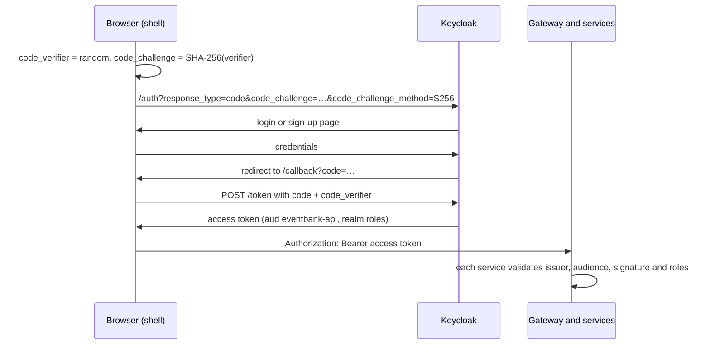

# EventBank identity

The Keycloak of [EventBank](https://github.com/marcelo-roman/eventbank-platform): a container image with the `eventbank` realm imported on first start. Signing in, signing up, verifying e-mails and resetting passwords all happen here; the services only validate the tokens it issues.

## The realm

| Piece | Setting |
| --- | --- |
| `eventbank-web` | Public client for the browser: authorization code with **PKCE S256 required**, no implicit flow, no password grant. Redirects to `http://localhost:3000/callback` |
| `eventbank-cli` | Public client with the password grant only, used by the seed script and the end-to-end tests to prepare data |
| Audience | Both clients add `eventbank-api` to access tokens; every service rejects tokens without it |
| Roles | `customer` is given to everyone who signs up; `operator` reviews applications and watches the platform |
| Sign-up | Open, with the e-mail as username, e-mail verification through Mailpit, and the password chosen after the e-mail is verified |
| Languages | English and Brazilian Portuguese; the shell asks for the visitor's language with `ui_locales` |
| Demo operator | `operator@eventbank.local` / `operator123` |

Keycloak 26.8 asks for the password only after the e-mail is confirmed when verification is on. Nobody can create an account with a password on an address they do not own.

## How the browser signs in



## Running it alone

```bash
docker compose up --build    # Keycloak on :8180 (admin / admin), Mailpit on :8025
```

The issuer is pinned to `http://localhost:8180` with `KC_HOSTNAME`, so the browser and the containers agree on it; `KC_HOSTNAME_BACKCHANNEL_DYNAMIC` lets the services fetch keys through the internal hostname.

## License

[MIT](LICENSE)
